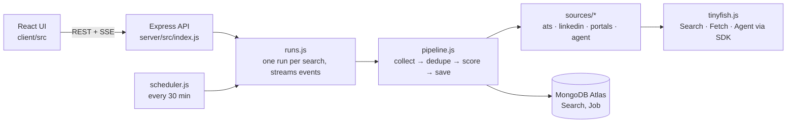
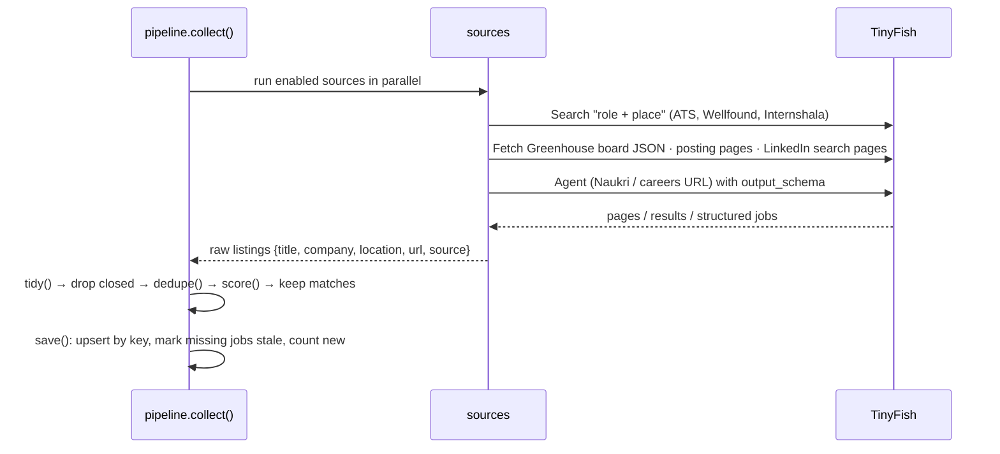
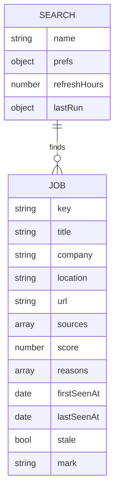

# Code map

About 1,100 lines in total, including the CSS. Read the files in the order below.

## 1. The big picture

## 2. One refresh, step by step

## 3. Files, in reading order

| #  | File                                                               | What it does                                                                                                     |
| -- | ------------------------------------------------------------------ | ---------------------------------------------------------------------------------------------------------------- |
| 1  | `server/src/prefs.js`                                            | Cleans the user's preferences; `combos()` = the (role, place) pairs every source searches                      |
| 2  | `server/src/tinyfish.js`                                         | SDK wrapper: `search()`, `fetchPages()` (batches of 10), `runAgent()` (stream, schema, timeout and cancel) |
| 3  | `server/src/sources/ats.js`                                      | Search on Greenhouse, Lever and Ashby, then Fetch whole Greenhouse boards and individual posting pages           |
| 4  | `server/src/sources/linkedin.js`                                 | Builds a LinkedIn search URL from the preferences and parses the job cards from the HTML                         |
| 5  | `server/src/sources/portals.js`                                  | Wellfound and Internshala: Search, then follow listing pages, then Fetch posting pages                           |
| 6  | `server/src/sources/parse.js`                                    | One tiny parser per site that turns a fetched page into a listing                                                |
| 7  | `server/src/sources/agent.js`                                    | Naukri and custom careers pages through the TinyFish Agent                                                       |
| 8  | `server/src/dedupe.js`                                           | `canonicalUrl` + `fingerprint` (company, title, city) merge duplicates                                       |
| 9  | `server/src/match.js`                                            | `score()`: role synonyms, seniority, location and NCR, keywords, recency → 0–100 plus reasons                |
| 10 | `server/src/pipeline.js`                                         | Ties it together: `collect()` then `save()`, and the `context` that counts TinyFish usage                  |
| 11 | `server/src/runs.js`                                             | Starts runs and streams their events to the browser over SSE                                                     |
| 12 | `server/src/models.js`, `db.js`                                | Mongoose models `Search` and `Job`, and the Atlas connection                                                 |
| 13 | `server/src/index.js`, `scheduler.js`                          | REST routes and the auto-refresh cron job                                                                        |
| 14 | `client/src/App.jsx`                                             | UI state: searches list, selected search, run events, jobs                                                       |
| 15 | `client/src/SearchForm.jsx` · `RunLog.jsx` · `JobList.jsx` | Preferences form · live progress · ranked jobs (filters, marks, CSV)                                           |

## 4. Data model

## 5. API

| Method              | Route                      | Purpose                                          |
| ------------------- | -------------------------- | ------------------------------------------------ |
| GET                 | `/api/searches`          | list saved searches                              |
| POST / PUT / DELETE | `/api/searches[/:id]`    | create, update or delete a search (and its jobs) |
| POST                | `/api/searches/:id/run`  | start a refresh and return `{ runId }`         |
| GET                 | `/api/runs/:id/events`   | progress stream (Server-Sent Events)             |
| GET                 | `/api/searches/:id/jobs` | ranked jobs                                      |
| PATCH               | `/api/jobs/:id`          | `{ mark: 'saved'                                 |
